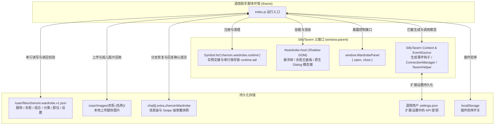
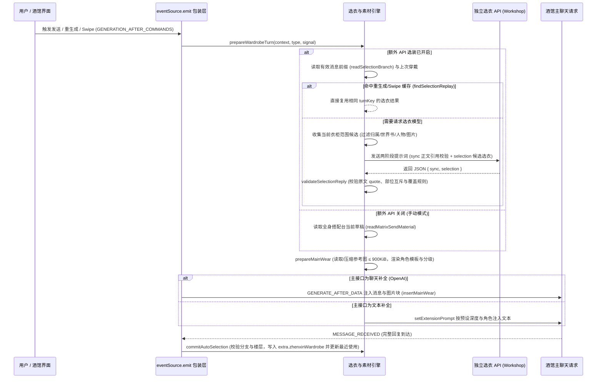

# 运行架构说明

[`index.js`](./index.js) 是插件的唯一运行入口。脚本在 SillyTavern「酒馆助手 (TavernHelper)」提供的沙箱环境中执行，通过 `window.parent` 访问宿主页面 DOM、`SillyTavern.getContext()` 与 `TavernHelper` 接口，并将自身 UI 挂载到父页面的 `#wardrobe-host` 节点下，利用 **Shadow DOM (`mode: 'open'`)** 实现样式与事件的完全隔离。

---

## 一、生命周期与实例交接

1. **单实例抢占与热重载交接**：
   * 父窗口通过 `window.parent[Symbol.for('zhenxin.wardrobe.runtime')]` 维护全局运行时记录 `{ owner, tail }`。
   * 新实例启动时，立即调用旧实例的 `owner.abort()`，并向已存在的 `#wardrobe-host` 派发 `wardrobe:dispose` 事件卸载旧 DOM 与事件钩子。
   * **等待前序写入落盘**：在读取存档前，新实例会 `await runtime.tail`，确保旧实例已经发出的数据库保存请求彻底完成后再读取快照，防止热重载读到脏旧数据。
2. **启动校验 (`readState` & `validateState`)**：
   * 请求 `/user/files/zhenxin.wardrobe.v1.json`（首次运行返回 `404` 时启用默认状态）。
   * 逐项校验顶层结构、穿戴部位定义 (`wearSlots`)、服饰记录 (`items`)、衣柜 (`wardrobes`)、组合 (`wardrobeGroups`)、分类 (`categories`) 与设置 (`settings`)。若部分条目存在格式问题，脚本会保留有效条目供浏览，同时记录 `storageIssues` 并将会话切入**只读保护模式**，防止覆盖损坏原文件。
3. **对外接口与卸载 (`dispose`)**：
   * 挂载完成后在宿主窗口暴露 `window.parent.WardrobePanel = { open, close }`。
   * 监听 `wardrobe:dispose` 与非 `persisted` 的 `pagehide` 事件（进入浏览器 bfcache 后退缓存时保留实例）；卸载时中止所有未完成请求、清理定时器、还原 `eventSource.emit` 包装、移除扩展菜单项与 `#wardrobe-host`。

---

## 二、数据存储与事务安全

| 数据类别 | 存储位置 | 存储内容与安全策略 |
| :--- | :--- | :--- |
| **衣柜主快照** | `/user/files/zhenxin.wardrobe.v1.json` | 通过 `/api/files/upload` 写入。保存服饰列表、衣柜、组合衣柜、分类、改名或新增的穿戴部位及预设配置（不含 API 密钥）。 |
| **本地服饰图片** | `/user/images/衣柜-{名称}/` | 通过 `/api/images/upload` 上传，文件名携带服饰 ID 与正背面标识；外链图片直接保存校验后的 HTTP(S) URL。 |
| **接口密钥** | `extension_settings['zhenxin.wardrobe'].apiKeys` | 按预设 ID 保存 `[预设 ID, 密钥]` 列表，随当前酒馆账户的 `settings.json` 和设置备份以明文保存。 |
| **插件启停状态** | `localStorage['zhenxin.wardrobe.enabled']` | 独立保存布尔开关，确保快照只读或异常时用户仍能随时开启或停用插件。 |
| **聊天穿戴记录** | `message.extra.zhenxinWardrobe` | 包含正文同步记录 (`sync`) 与轮次选衣记录 (`turn`)，并自动同步至当前 `swipe_info[swipe_id].extra`，随酒馆聊天文件原生保存。 |

启动时通过 `SillyTavern.getContext().extensionSettings` 取出密钥。酒馆尚无 `apiKeys` 字段时读取旧 `sessionStorage`；已保存的空列表表示密钥已清空。提交 API 预设时先写衣柜快照，再调用 `saveSettingsDebounced()` 委托酒馆保存密钥。收到宿主的 `SETTINGS_UPDATED` 后清理旧会话副本，10 秒内仍未收到事件则保留当前表单供重试。

### 1. 串行队列与写回核对 (`enqueueStateOperation` & `writeStateSnapshot`)
* 所有前台保存与后台最近使用时间更新均通过 `enqueueStateOperation()` 挂载到 `runtime.tail` 串行执行，并在保存期间锁定面板输入（`guardSavingForm`），杜绝并发写入覆盖。
* 上传快照时，若 `/api/files/upload` 响应异常或未明确返回路径，脚本会立即重新请求 `STORAGE_PATH` 读回文件内容并与本次序列化的 JSON 逐字比对：
  * 若读回内容一致，视为保存成功；
  * 若无法确认写入结果，脚本立即进入只读保护模式并保留当前表单草稿与已上传图片，提示用户重载核对。

### 2. 图片事务回滚与孤儿图片回收
* **上传失败回滚 (`rollbackWardrobeImageUploads`)**：新增服饰、编辑详情或导入数据包时，若图片已上传但后续快照写入明确失败，脚本会自动调用 `/api/images/delete` 清理本次刚上传的图片文件。
* **孤儿图片回收 (`reclaimOrphanImages`)**：当删除服饰、覆盖导入或更换正背面图片且数据库快照确认保存成功后，脚本会扫描全库剩余卡片的 `frontUrl` 与 `backUrl`；若旧的 `/user/images/` 本地图片不再被任何卡片引用，则在后台自动将其删除。

---

## 三、聊天发送拦截与两阶段自动选衣

脚本通过 `installWardrobeSending()` 包装酒馆 `eventSource.emit`，在宿主修改聊天楼层之前异步介入生成生命周期。

### 1. 候选池过滤与穿戴组件拆解 (`collectSelectionCandidates` & `wearComponents`)
自动选衣启动时，仅从顶栏当前选中的单衣柜或组合衣柜中收集候选，并依次执行过滤：
1. **排除未确认子卡**：带有 `splitParent` 但穿戴部位为「待确认」的拆分子卡不作为整套候选。
2. **归属匹配**：归属需为 `USER 玩家`、`Char 角色` 或 `双人通用`。
3. **世界书激活检查**：若开启了 `wbEnabled`，所绑定的 `boundWorldbook` 必须存在于当前激活的全局世界书、角色主/附加世界书、聊天世界书或用户人设世界书中。
4. **人物名称绑定**：若设置了 `boundChars`，需与当前聊天的 `name1` (USER) 或 `name2` (Char) 精确匹配。
5. **纯图模式检查**：当发送内容设为「仅图片」时，候选卡片必须至少包含正面或背面图片。

随后，`wearComponents()` 将每张卡片解析为具体的部位组件：单品卡对应单一部位；搭配台套装 (`item.outfit`) 与自动拆分母卡 (`item.splitParts`) 会展开为各自的部位子卡列表，供局部穿脱与整套替换计算。

### 2. 两阶段选衣协议与严格校验 (`validateSelectionReply`)
发给选衣模型的请求固定使用低温采样（`SELECTION_TEMPERATURE = 0.2`），要求模型输出包含 `sync` 与 `selection` 的 JSON：
* **第一阶段 `sync`（正文明确穿脱同步）**：
  * 仅处理上次同步游标 (`through`) 之后、在读取窗口内的未同步消息及本次用户输入 (`pending`)。
  * 模型报告的每一处穿脱变化都必须提供 `who`、`slot`、`action` 以及**逐字匹配的原文引用 `quote`**（脚本会执行 `source.text.includes(change.quote)` 校验，防止模型把联想或未发生的计划当作已发生的事实）。
* **第二阶段 `selection`（候选池主动选装）**：
  * 在 `sync` 更新后的穿戴基础上，从 `candidates` 中为 `user` 或 `char` 选择换装或脱衣，并附带一句理由 `reason`。
  * **部位冲突与优先级校验 (`applyWearChange`)**：
    * `dress`（连身）与 `top`（上装）、`bottom`（下装）互斥；`accessory`（配饰）允许同部位多件并存；
    * 穿戴部位未确认的整套服饰（`outfit`）不允许在非正文强制的情况下进行局部单件替换；
    * **正文优先铁律**：`selection` 严禁覆盖同一轮 `sync` 中刚刚由正文明确穿脱的部位。

### 3. 分支回溯、重生成缓存与延迟提交
* **前缀哈希链 (`extendContentKey`)**：脚本对当前分支的每条非系统消息计算双种子滚动哈希（32位 FNV-1a 变体），形成与消息内容强绑定的前缀键 `key`。若用户编辑了历史消息或切换了 Swipe 分支，哈希链变化会自动使不匹配的旧记录失效，并回溯到最近一条有效记录。
* **重生成与 Swipe 复用 (`findSelectionReplay`)**：当触发 `regenerate` 或 `swipe` 时，若上下文、候选池与提示词计算出的 `turnKey` 与被替换回复中的记录完全一致，脚本会直接复用上次的选衣结果，省去重复的 API 调用。
* **完整回复后提交 (`commitAutoSelection`)**：选衣结果在生成期间仅暂存在内存的 `wardrobeTurn` 中；只有当匹配本轮类型、同一聊天分支且 `gen_finished` 的完整 AI 回复到达时，才会正式写入用户楼层（`sync`）与 AI 回复楼层（`turn`）的 `extra.zhenxinWardrobe`，并更新所穿服饰的 `lastUsedAt` 时间戳。若生成被中途停止或报错，当轮暂存状态立即丢弃，并自动恢复用户输入框中的 `/trigger` 或 `/regenerate` 命令草稿。

---

## 四、脱敏诊断日志系统

为方便排查跨端接口与图片问题，同时保护用户隐私与密钥安全，脚本内置了零泄露设计的诊断日志系统：
1. **环形缓冲限制**：内存日志缓冲区最多保留 `2000` 条记录或 `16 MB` UTF-8 字节数（超出时自动按 FIFO 淘汰旧记录并统计 `evictedCount`）。
2. **多层自动脱敏 (`redactDiagnostic` & `redactDiagnosticText`)**：
   * 自动将 Base64 图片正文替换为 `[图片正文已省略]`，将 HTTP(S) URL 替换为 `[地址已省略]`；
   * 自动识别并遮盖 `api_key`、`authorization`、`cookie`、`token`、`password`、`secret`、`Bearer/Basic` 凭证、JWT (`eyJ...`)、`sk-...` 密钥及运行时 `apiKeys` 中的所有明文与 URL 编码形式，统一替换为 `[已脱敏]`；
   * 捕获宿主异常 (`diagnosticErrorDetails`) 时，仅提取安全的标准错误类型、HTTP 状态码、JSON 语法行列位置与源码行列号 (`(源码:行:列)`)，剥离可能包含私有路径或查询串的外部堆栈与原始报错正文。
3. **手动诊断隔离 (`previewDiagnosticText`)**：日志弹窗中的「手动诊断（临时查看请求与响应原文）」默认关闭；开启后仅在独立的临时内存对象中展示最近一次不含疑似凭据的提示词与模型回复，**绝不进入日志缓冲区，也不会随「复制日志」或「导出日志」外流**。

---

[返回项目首页](./README.md) · [界面与交互设计](./DESIGN.md) · [常见问题解答](./FAQ.md)